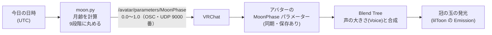

# NeroMoon

VRChat のオリジナルアバター「ネロ」の冠の月を、**その日の本当の月の満ち欠けに合わせて自動で光らせる** Windows 用の常駐アプリです。

<!-- スクショを docs/ に置いたら、次の行のコメントを外す -->
<!--  -->

## 何をするか

ネロの頭には、新月→満月→新月と並んだ 9 個の玉（月齢の冠）があります。
黙っているあいだは「今夜の月」の玉だけが光り、話しているあいだは声に合わせて外側から順に光ります。

NeroMoon は、この「今夜の月」を毎日手で合わせなくて済むようにするアプリです。

- PC の起動と同時に裏で動き、60 秒ごとに今日の月齢を VRChat に送る
- 画面右下（タスクトレイ）に月のアイコンを出し、右クリックで「いまの月の確認・今すぐ送信・自動起動のオン／オフ・終了」ができる
- アバターを他の人に渡しても、相手は **VRChat の OSC をオンにして exe を 1 回ダブルクリックするだけ**で使える

## しくみ



1. **月齢の計算（`moon.py`）**：実際にあった新月（2000 年 1 月 6 日 18:14 UTC）からの経過日数を、朔望月（29.530588853 日）で割った余りを月齢とします。
2. **9 段階への丸め**：月齢を 0.0〜1.0 にして、`0, 0.125, … , 1.0` の 9 段階に丸めます。
3. **送信（`nero_moon_app.py`）**：[python-osc](https://pypi.org/project/python-osc/) で VRChat の OSC（`127.0.0.1:9000`）に送ります。
4. **アバター側**：Unity の Animator で、`MoonPhase` の値に応じて 9 個の玉のどれを光らせるかを決めます。声の大きさ（`Voice`）が大きいときは、声のほうを優先して外側から光らせます。

## このリポジトリの中身

| ファイル | 中身 |
| --- | --- |
| `moon.py` | 月齢の計算だけ。標準ライブラリだけで動く |
| `nero_moon_app.py` | トレイ常駐・OSC 送信・自動起動の登録・二重起動の防止 |
| `tests/test_moon.py` | 月齢の計算のテスト（2026 年の新月・満月の日で確かめる） |
| `build_exe.bat` | 必要なライブラリを入れて `NeroMoon.exe` を作る |
| `はじめにお読みください.txt` | アバターを受け取った人向けの説明書 |
| `unity-editor/` | アバター側で使った Unity のエディター拡張（[説明](unity-editor/README.md)） |

## 使い方

### アバターを受け取った人

`はじめにお読みください.txt` のとおりです。

1. VRChat で Action Menu → Options → OSC → Enabled をオンにする
2. `NeroMoon.exe` をダブルクリックする（初回だけ。次からは PC の起動時に自動で動く）

### 自分で exe を作る

Windows と Python 3 が必要です。

```bat
build_exe.bat
```

`dist\NeroMoon.exe` ができます。exe にせず動かすだけなら、次のコマンドで動きます。

```bat
pip install python-osc pystray pillow
pythonw nero_moon_app.py
```

## テスト

月齢の計算は Windows や VRChat がなくても確かめられるように、`moon.py` に分けてあります。
外部ライブラリは要りません。

```bash
python -m unittest discover -s tests -v
```

国立天文台「[令和 8 年（2026）暦要項](https://eco.mtk.nao.ac.jp/koyomi/yoko/2026/rekiyou263.html)」の新月 12 回・満月 13 回の日について、その日の正午（日本時間）に正しい玉（新月なら両端、満月ならてっぺん）に丸められることを確かめています。
GitHub Actions でも、push のたびに同じテストを回しています。

## 設計で決めたこと

- **9 段階に丸める**：冠の玉は 9 個です。間の値を送ると、隣り合う 2 つの玉が半分ずつ光ってしまうので、送る前に丸めます。
- **60 秒ごとに送り直す**：メニューで月齢を手で動かしたり、アバターを着替え直したりしても、1 分以内に今日の月に戻るようにしました。日付が変わったときも、操作なしで次の月齢に切り替わります。
- **タイムゾーンのない日時はエラーにする**：日本時間と UTC を取り違えると最大 9 時間ずれます。黙って計算せず、`ValueError` で止めます。
- **計算と画面を分ける**：トレイや OSC はテストしにくいので、計算だけを `moon.py` に切り出しました。
- **管理者権限を使わない**：自動起動は、ログイン中のユーザーのレジストリ（`HKCU\...\Run`）に登録します。二重起動は Windows の Mutex で防ぎます。
- **VRChat を起動していなくても落ちない**：OSC は UDP なので、受け取る側がいなくても送信は失敗しません。送信で例外が出ても、アプリは止めずに次の 60 秒を待ちます。

## 制約

- 月齢は「平均の朔望月」で計算しているので、実際の月とは最大で半日ほどずれます。9 段階に丸めるので、見た目にはほとんど影響しません。
- PC 版 VRChat 専用です。Quest 単体では動きません（その場合も、アバターのメニューから手動で月齢を選べます）。
- 個人で作った exe なので、初回は Windows の警告（「Windows によって PC が保護されました」）が出ることがあります。

## 開発について

アバター（Blender でのモデリング、Unity での設定）と、このアプリの仕様は自分で考えました。
「アバターを渡した相手が操作しなくて済むように」という要件から、常駐化・自動起動・exe 化を決めています。
コードは生成 AI（Claude）に書かせ、自分の PC でビルドと動作確認をしました。
公開にあたって、計算部分の切り出しとテストを追加しています。

## ライセンス

[MIT](LICENSE)
